# LOOM-8 manual

LOOM-8 turns the M-VAVE FM-1 into a pocket groovebox: eight threads of sound on a 64-step loom. Eight tracks
with synth engines and a drum synth, a 64-step sequencer with fourteen step tricks and parameter locks,
players, twelve throws (momentary effects) per octave, a conductor that moves the song through a progression,
two send effects (the reverb with the PlayStation's own reverbs among its modes), a mixer and a master section
with a tape, sixteen scenes and a song. Weave two patterns into a
third, bar by bar, step by step, or one's rhythm with the other's notes.

The loop LOOM-8 is made for: write a short pattern, add a few tricks, weave it with another, let the conductor
play a progression, season it with throws while it plays, then put the scenes in order.

- [Quick start](#quick-start)
- [Cheat sheet](#cheat-sheet)
- [Getting around](#getting-around)
- [Steps](#steps)
- [Recording](#recording)
- [Sounds](#sounds)
- [Players](#players)
- [Arrange, scenes and the song](#arrange-scenes-and-the-song)
- [The aux tracks](#the-aux-tracks)
- [Mix and master](#mix-and-master)
- [Saving](#saving)
- [Page by page](#page-by-page)
- [Screen reader](#screen-reader)

## Quick start

Ten minutes from a blank project to a jam. White keys are numbered 1
to 16 from the left, black keys 1 to 11.

1. **A beat.** Turn **ALGORITHM** until the tag line says T1 kit. Press **SEQ**. Black key 1 is the
   kick: press it, then white keys 1, 5, 9 and 13. Press black key 2 for the snare and press white keys 5 and
   13. Press black key 3 for the hat and press every other white key. Press **PLAY**.

   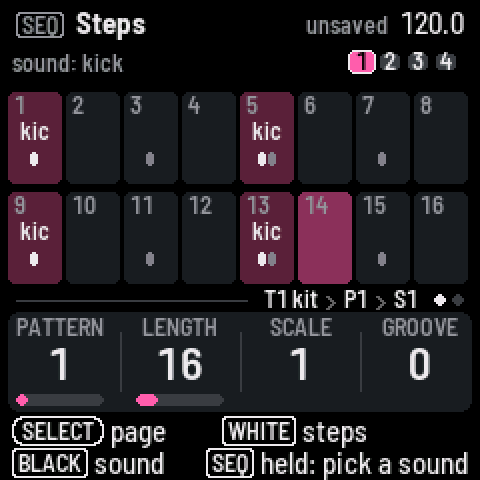
2. **A bass line.** Turn **ALGORITHM** to T2 stack. On the Steps page, hold **SEQ** and play a low note:
   the keys are a keyboard while **SEQ** is down, and the note is remembered. Let go and press white keys 1, 4,
   7 and 11. Hold **SEQ**, play another note, let go and press white key 14. Or tap **REC** and play the
   notes one after another: each one goes on the next step. Press **EDIT** and turn **KNOB 1** while it plays
   to hear the shape change.

   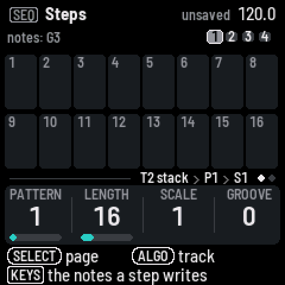 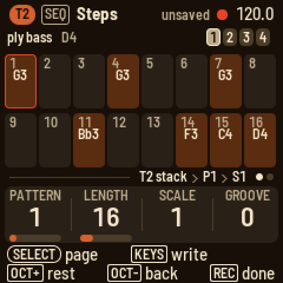
3. **Tricks.** Still on T2's Steps page, hold **HOME**, hold white key 7, and press white key 3: multiply.
   Press black key 3 for three hits. Let go. Hold **HOME**, hold white key 14, press white key 11: jump, and
   black key 7 for "forward or back": the pattern starts to wander. Hold **HOME**, hold white key 1 and press
   white key 14: skip trigger, so step 1 plays every other pass.

   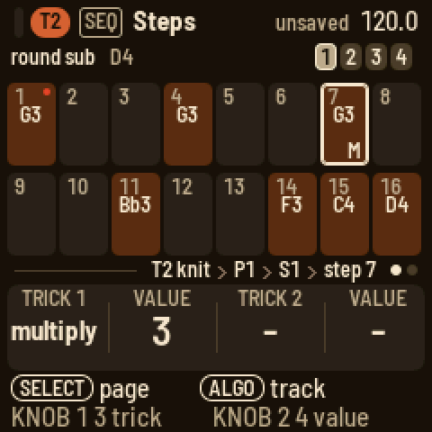
4. **A chord track.** Turn **ALGORITHM** to T3. Press **EDIT** and turn **PRESETS** until a pad you like
   comes up. Press **SEQ**, hold **SEQ** and hold three keys together, let go and press white key 1. Hold white
   key 1 and press white key 8 so the chord lasts half the bar: a bar under the cells shows how far it
   reaches. Hold **SEQ** and three keys a little higher, let go and press white key 9. The cells name the
   chords.

   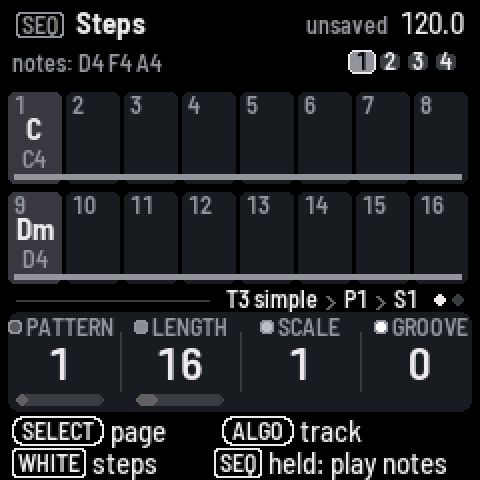
5. **The conductor.** Turn **ALGORITHM** to COND (the conductor). Press **EDIT**: the key is C major and T2 and T3 follow.
   Play an F, then a G, then a C while it plays: everything moves with you, in the scale. Press **SEQ**, turn
   **SELECT** for the Bar page and press black key 4 so a step is a beat. Back on Steps, hold **SEQ** and play
   a chord, let go and press a step, and so on: four steps are a bar of progression.

   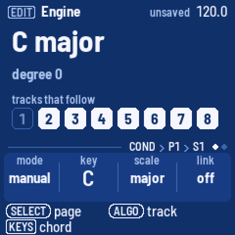
6. **Throws.** Go to any track's **EDIT** page. Hold **HOME** and press a low key: F3 mutes the
   drums, G3 stutters them, B3 echoes, C4 builds, D4 plays four on the floor, E4 jumbles them. Hold **HOME** and press a high
   key for the same on the melodic tracks. Let go and the pattern comes back.

   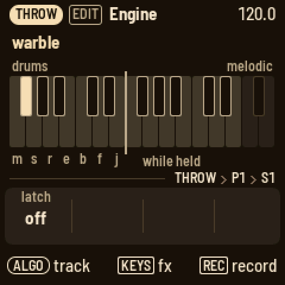
7. **A scene.** Press **HOME**. White key 1 is the scene playing. Press white key 2: a copy. Now change
   something: mute the drums with black key 1 on Arrange, or go to T2's Steps and turn **KNOB 1** to
   P2 for a new pattern. Press white key 1 and 2 in turn to switch between them at once, or hold **HOME** and
   press one to switch at the bar.

   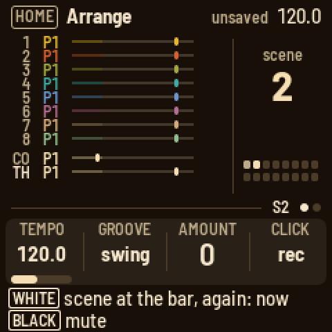
8. **Save.** Press **SAVE**.

From here: hold a step to see its velocity, length, chance and nudge; hold a step and press **EDIT** to lock a
knob on it; press **ARP** on T2 and turn **KNOB 1** to arp; press **GLO**, turn **SELECT** to Master tape and turn
**KNOB 3** while it plays. Hold any button for a second and a card explains it.

## Cheat sheet

### The words

- **Track** (T1 to T8): one sound and its patterns. After T8 come the aux tracks: COND (the conductor), THROW (the throws), FX I
  and FX II.
- **Pattern** (P1 to P8): a track's steps, up to 64 of them in four bars. Each track has eight.
- **Step**: one cell of a pattern. It holds up to four notes, two tricks, a chance and parameter locks.
- **Trick**: something a step does as it plays, such as pulse, hold, multiply or jump. There are fourteen, on the
  white keys while you hold HOME and a step.
- **Lock**: a knob value a step sets as it plays.
- **Scene** (S1 to S16): which pattern each track plays, plus the mutes and the conductor's key.
- **Song**: a chain of scenes, each played a number of times.
- **Engine**: the way a track makes its sound. Eight synths and the kit, a drum synth.
- **Preset**: a sound to load. 64 come with LOOM-8, and 16 are yours.
- **Player**: what the keys do on a track: arp, strum or hold.
- **Conductor**: the aux track that moves the other tracks through a key and scale.
- **Throw**: a momentary effect on the drums or the melodic tracks, from a key while you hold HOME.
- **Weave**: a pattern crossed with a copied one: bars or steps in turn, or one's rhythm with the other's notes.
- **Groove**: a timing and velocity feel. The project picks the type, each track sets how much.

### How do I…

White keys are numbered from the left, 1 to 16, and black keys the same way, 1 to 11. "Hold **HOME** and
press…" means keep **HOME** down while you press the next thing.

| How do I… | Do this |
| --- | --- |
| pick a track | Turn **ALGORITHM** on any page. |
| write a beat | Press **SEQ**. On a drum track, black key 1 is the kick: press it, then white keys 1, 5, 9 and 13. Black key 2 is the snare. |
| write a note | On Steps, hold **SEQ** and play the note, let go, and press a white key: the note goes on that step. |
| write a chord | On Steps, hold **SEQ** and hold the notes together, let go, and press a step. |
| pick a drum sound | On a drum track's Steps page, press its black key, or hold **SEQ** and press any key. |
| see a step | On Steps, hold its white key. The knobs show its velocity, length, chance and nudge. |
| make a note longer | Hold its step and press a later white key. A bar under the cells shows how far a note reaches. |
| nudge a step | Hold its step and press **OCT−** or **OCT+**. |
| put a second sound on a drum step | Hold the step and press the sound's black key. |
| take one note off a step | Hold the step, press **SEL**, pick the note and press **SEL**. |
| add a trick | Hold **HOME**, hold the step, and press a white key: 1 pulse, 2 hold, 3 multiply, 4 velocity, 5 ramp up, 6 ramp down, 7 random, 8 portamento, 9 bend, 10 tonality, 11 jump, 12 skip lock, 13 skip trick, 14 skip trigger. Press a black key for its value: 1 to 9, black key 10 for random. The same white key again takes it off. |
| set a skip's pattern | With **HOME** and the step held, black key 11 cycles between "on the last pass", "not the last pass" and "only the first". |
| give a step a chance | Hold the step and turn **KNOB 3**. Past 99 % come the A:B cycles. |
| lock a knob on a step | Hold the step and press **EDIT**, **ENV**, **FX** or **LFO**. Turn a knob. **SAVE** clears the step's locks. |
| see the next bar | Press **OCT+** on Steps. |
| set the track scale | On the Bar page, press a black key: 1, 2, 3, 4, 5, 6, 8, 16 sixteenths a step, or black key 9 for half a sixteenth. |
| change the pattern | On Steps, turn **KNOB 1**. Playing, it comes at the next bar line: the knob reads NEXT 1>2 and the tag line "next P2" until it does. |
| weave two patterns | Copy one (**SEL**, COPY PATTERN), go to the other, **SEL**, WEAVE WITH COPIED: **ALGORITHM** picks bars, steps, rhythm or notes. **SEL** does it. |
| change the sound | Press **EDIT** and turn **PRESETS**: the engine's own sounds, "PRESET 3/8". **SEL** changes the engine. |
| edit a drum sound | On a drum track, press **EDIT** and press the sound's black key. The knobs are the model's own four. Turn **SELECT** for the model, random, pan and volume; its **SEL** list has the play mode. |
| shape one drum | On a drum track, press **ENV** and press the drum's black key: its own attack, hold, decay and lag. Turn **SELECT** for its filter: **PRESETS** picks low-pass, high-pass or band-pass, the knobs cutoff, resonance, envelope and drive. |
| play a sample | On a drum track, turn a key's model to sample. On a synth track, **SEL** and ENGINE: sample. The sample knob picks it. |
| load my own samples | Connect the FM-1 by USB and run `tools/loom_samples.py load kick.wav snare.wav` on the computer. They come after the factory samples, as user 1, user 2 ... |
| chop a break | On a synth track, **SEL** and ENGINE: slice. Each key plays a slice of the break, F3 the first; write them on the steps in any order. Load your own with `tools/loom_samples.py load "amen.wav@2"` (a loop of 2 bars). |
| change the filter | Press **ENV** and turn **SELECT** to Filter. **PRESETS** turns the filter type. |
| give a sound some character | Press **FX**: the Character page. **PRESETS** turns the type (drive, fold, crush, ring, tilt); the knobs are its amount, tone and mix. |
| use the effects | Press **FX** and turn **SELECT** to Sends: the track's sends. Turn on for FX I and FX II; **PRESETS** picks the effect. |
| play | Press **PLAY**: every track starts from step 1. |
| record live | Hold **REC** and press **PLAY**: it records from step 1 at once (after the count-in, if set). |
| record while playing | Hold **REC** and play: it records while you hold it. Hold **REC** and press **PLAY** to keep it on. |
| set the click, count-in, quantise | Hold **REC** and turn the knobs: CLICK, COUNT, QUANT, MODE (overdub or replace). |
| record step by step | Stopped, on Steps, tap **REC**. The red cursor starts after the last note; each key (or chord) you play writes it and moves on. **OCT+** leaves a rest, **OCT−** goes back. **REC** again ends. |
| undo | Hold **HOME** and press **REC**. Hold **HOME** and press **PLAY** to redo. |
| set the tempo | Press **HOME** and turn **KNOB 1**. Hold **HOME** and turn it for tenths. On any page, hold **HOME** and turn **SELECT**. |
| use a throw | Hold **HOME** and press a key. The lower octave works on the track you are on, the upper octave on its whole group. |
| make a new scene | Press **HOME** and press an empty white key. It becomes a copy of the scene playing. |
| cue a scene at the bar | On Arrange, hold **HOME** and press the scene's white key. |
| mute a track | On Arrange, press its black key. On Mix, hold **HOME** and press its black key. |
| solo a track | On Mix, hold its black key. Let go, and the mutes come back. |
| play a progression | Turn **ALGORITHM** to COND (the conductor). Press **EDIT** and play a chord: it moves the tracks that follow. Press **SEQ** and press a step: the chord goes on it. Set the scale to 4 on the Bar page so a step is a beat. |
| save | Press **SAVE**. Hold **SAVE** and press white key 1 to 3 to save to that slot. |
| keep a sound | On a sound page, hold **SAVE** and press a white key. The sound becomes that user preset. |
| load a project | Press **GLO**, turn **SELECT** to Setup, press **SEL** and pick LOAD PROJECT. |

### The buttons

| Control | What it does |
| --- | --- |
| **PLAY** | Starts (every track from step 1) and stops. A track whose scale or length you change stays in phase with the rest. On the Song page, it plays the song. With **REC** held, it starts live recording. |
| **REC** | Held while playing: records while held. Stopped: a tap arms step record. Held, the knobs are the record settings (click, count-in, quantise, mode). On Players with strum, it records the chord. |
| **SEL** | Opens a list of this page's settings and actions. With a step held, its notes. When LOOM-8 asks a question, **SEL** means yes. |
| **HOME** | Opens Arrange. On Arrange, it opens the Song page. Held, it is the shift key: tricks, throws, undo and redo, the fine tempo, scenes, mutes on Mix. When LOOM-8 asks a question, **HOME** means no. |
| **SEQ** | Opens Steps. Its page 2 is Bar. Hold it on Steps and the keys play the track and set what a step writes. |
| **EDIT** | Opens Engine. Its page 2 is Play; on a drum track, the key's model, random, pan and volume. |
| **ENV** | Opens Envelope (a drum track: lag, attack, random, length), then Filter, then the filter's envelope. |
| **FX** | Opens Character, the track's own effect. Then Sends, the track's sends to FX I and FX II. Then FX I and FX II, the two effects. |
| **LFO** | Opens LFO. Its page 2 has the type's fourth and fifth knobs. |
| **ARP** | Opens Players. With the arp, page 2 is its second set of knobs and page 3 is hold. |
| **GLO** | Opens Mix. Turn **SELECT** for Master EQ, Master tape, Master out, Setup and Status. |
| **SAVE** | Saves. Hold it and press a white key to save to a slot, or to keep a sound. With a step held, clears its locks. |
| **OCT−** / **OCT+** | Move the keys an octave. On Steps, show the bar before or after; with a step held, nudge it. In step record, move the cursor. |
| **SELECT** | Turns to a button's next page. In a list, it moves up and down. |
| **ALGORITHM** | Picks the track. In a list, it changes the row's value. |
| **PRESETS** | Steps to the next item of whatever the page shows: a preset, a drum key, an effect, a pattern, a drum sound, a scene. |
| **KNOB 1–4** | Set the four values at the bottom of the screen. |

Hold any button for a second, and a card explains it. The two lines at the bottom of the screen always say
what each control does on the page you're on.

## Getting around

### The screen

From top to bottom, the screen has five parts.

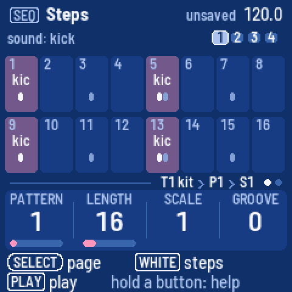

- **The header** shows the page's button and name, the tempo, a red dot while recording, and "unsaved".
  Messages and questions cover it for a moment.
- **The middle** is the page itself.
- **The tag line** says where you are: the track and its engine, the pattern and the scene, such as
  "T3 stack › P2 › S1". The dots at the right say which of the button's pages you're on.
- **The knob strip** shows the four knobs' names and values, each with a bar in the track's colour. The
  knob you just turned shows in the text colour.
- **The two bottom lines** say what the encoders and the keys do here.

The screen comes in two themes (Setup, THEME): **tape deck**, warm brown-black with cream text, and
**blueprint**, deep blue with white lines. In both, every instrument track has its own colour; in tape deck
T1 mustard, T2 rust, T3 olive, T4 teal, T5 blue, T6 plum, T7 tan, T8 sage. A track's steps with notes are
its colour, dimmed; what sounds now is its colour, bright: the step playing, the scene playing, a meter. On
Arrange and Mix every track keeps its colour, so you can tell them apart at a glance. Cream (or white)
outlines are you: the held step, the cursor, the knob you turned. Red is only for recording and for locks.

### Messages

Short messages cover the header for a moment. **i** is news, **✓** is something done, an arrow is an undo
or redo, **?** on red is a question that waits for **SEL** or **HOME**, and **!** means LOOM-8 could not do it
and says why.

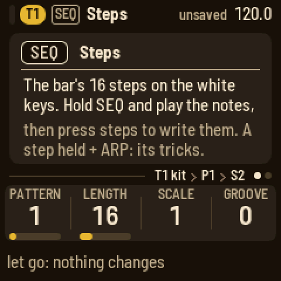

### The tracks

Turn **ALGORITHM** to pick a track: T1 to T8, then COND (the conductor), THROW (the throws), FX I and FX II. The keys play the
track you picked on the Engine, Play, Envelope, Filter, LFO and Players pages. On a drum track, the black
keys are the eleven drum keys, and the white keys play them too. On FX I and FX II, the keys play the
instrument track you picked last, so you hear the effect.

### The lights

**PLAY** is green while playing and red while recording. **REC** lights while recording or armed. **SAVE**
lights when there is something to save. The page's button is lit. On Steps, the steps with notes glow and the
step playing is bright; with **HOME** and a step held, the white keys of its tricks light. On Arrange,
the scenes in use glow and the one playing is bright. The muted tracks' black keys glow. With Setup's LIGHTS
on, the other buttons glow too.

## Steps

Press **SEQ**. The main band shows one bar of the pattern as 16 cells, and the 16 white keys are those
cells. The top line says what a press writes: on a drum track, the sound shown; on a synth track, the
remembered notes, which are the last keys you held together on a play page; on the THROW track, the last
effect you played. The four squares at the right are the bars.
**OCT−** and **OCT+** show the bar before or after.

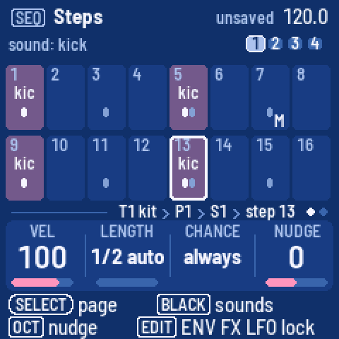

- **Hold SEQ and play keys** to choose what a step writes: the keys play the track, and the ones you hold
  together become the remembered notes (a chord). On a drum track, the key you play becomes the sound shown.
  Let go of **SEQ** and nothing else changes.
- **Press a white key** to put the remembered notes on that step, or to clear the step.
- **Hold a white key** to see the step. **KNOB 1** is its velocity, **KNOB 2** its length in steps, **KNOB 3**
  its chance (always, a percentage, then the A:B cycles: on the A-th of every B passes) and **KNOB 4** its
  nudge. **OCT−** and **OCT+** nudge it too.
- **Hold a step and press a later white key** to make its note reach that step.
- **Hold a step and press a black key** on a drum track to put that sound on the step, or take it off.
- **Hold a step and press SEL** for a list of its notes. Pick one and press **SEL** to take it off.

### Tricks

Hold **HOME** and hold a step. The white keys are now the fourteen tricks, and the
black keys are their values. Press a white key to add its trick; press it again to take it off. A step
holds two; a third replaces the second. While you hold, the knob strip shows the step's two tricks and
their values, and the white keys of the ones it has are lit.

| White key | Trick | Black keys 1 to 9, 10 = random |
| --- | --- | --- |
| 1 | pulse: repeat the step without moving on | 1 to 9 times |
| 2 | hold: keep the note over the next steps | 1 to 9 steps |
| 3 | multiply: retrigger the step | 1 to 9 hits |
| 4 | velocity | 4, 8, 16, 32, 64, 100, 112, 127, 0 |
| 5 | ramp up: the note climbs the scale each pass | 2 to 6 steps over one octave, then over three |
| 6 | ramp down | the same |
| 7 | random: another note of the scale each pass | the same |
| 8 | portamento: glide into the note | 10 % to 80 %, then off |
| 9 | bend | down-up, up-down, bumps, springs, fades, random 1 and 2 |
| 10 | tonality: how the step takes the conductor | ignore, transpose only, octave up, fifth up, third up, chromatic up, chromatic down, quantize 33 %, 66 %, 100 % |
| 11 | jump: move the playhead | to step 1, 5, 9, 13, forward, back, either, stay, align |
| 12 | skip lock: the locks play every Nth pass | a cycle of 1 to 9 |
| 13 | skip trick: the other trick plays every Nth pass | a cycle of 1 to 9 |
| 14 | skip trigger: the step plays every Nth pass | a cycle of 1 to 9 |

For the three skips, black key 11 cycles which pass of the cycle plays: the last, all but the last, or only
the first. A new trick starts at its default: pulse and hold 4, multiply 2, velocity 64, the
ramps and random 4, portamento 40 %, bend down-up, tonality fifth up, jump forward, the skips a cycle of 2.

A step's chance and its skip trigger decide whether the step happens at all. When it does not, its tricks do not
either, a jump included: a jump with a 25 % chance jumps about one time in four. A jump back, or stay, starts a new
pass, so the A:B cycles, the skips and the ramps keep counting inside the loop it makes.

A cell shows its note, two notes one over the other, or the first note and how many more ("+2"). A chord shows
its name with its bass note under it; a name too long for the cell is shortened (CM7 for maj7, C+ for aug, Co for
dim, Cs2 and Cs4 for the sus chords), and one still too long (C#M7, Ebm7) puts the root over its quality. An
effect on the throw track shows three letters (PAN) over its group (drm or mel). On a drum track, every sound on the
step has a tick, the shown sound's bright, so the whole beat is visible while you edit one sound. A bar along
the foot of the cells shows how far a long note reaches; an arrow at the bar's end means it goes on. The
tricks' letters sit at the bottom right, a percent sign marks a chance, and a red dot marks locks.

### Locks

Hold a step and press **EDIT**, **ENV**, **FX** or **LFO**. The knob strip becomes that module's four knobs
for the held step (turn **SELECT** for its other pages: **ENV** has the envelope, the filter and the filter's
envelope; **FX** the character and the sends), showing "–" where the step has no lock and the locked values in red. Turn a knob to lock
a value on the step. Let go of the step to go back. Hold a step and press **SAVE** to clear its locks. While
recording, a knob you turn writes locks on the steps as they play. The Bar page's SHAPE knob smooths between
locks.

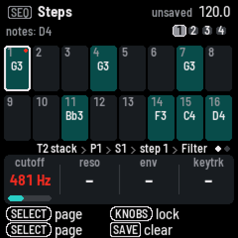

### The Steps knobs and the Bar page

With no step held, **KNOB 1** picks the pattern (P1 to P8), **KNOB 2** the length in steps, **KNOB 3** the
track scale (how many sixteenths a step takes, from 1/2 to 16) and **KNOB 4** the track's groove amount.

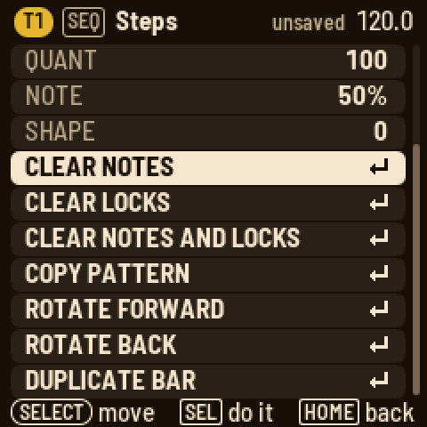

Turn **SELECT** for the Bar page: quantise for live recording, the note length of new steps as a percentage
of a step, the groove amount and the shape. The black keys set the track scale: 1, 2, 3, 4, 5, 6, 8, 16
sixteenths a step on black keys 1 to 8, half a sixteenth on black key 9. Press **SEL** on either page for the
actions: clear notes, clear locks, clear both, copy and paste the pattern, rotate it a step forward or back,
duplicate the bar into the next. Once a pattern is copied, the list also has WEAVE WITH COPIED.

### Weave

Weave crosses the pattern you are on with the one you copied. Copy a pattern (**SEL**, COPY PATTERN), go to
another (**KNOB 1**), press **SEL** and pick WEAVE WITH COPIED. Turn **ALGORITHM** for how, then press
**SEL**:

| Way | What this pattern becomes |
| --- | --- |
| bars | its bars 1 and 3, the copy's bars 2 and 4 |
| steps | its odd steps, the copy's even steps |
| rhythm | its rhythm, playing the copy's notes in their order, round and round |
| notes | the copy's rhythm, playing this pattern's notes |

With bars and steps the shorter pattern loops to the longer one's length. The pattern keeps its own scale,
groove and note length, and its locks. Not what you wanted? Hold **HOME** and press **REC** to undo, then try
another way. Weave a pattern with a copy of itself shifted (copy, ROTATE FORWARD, weave by steps) for
variations; weave a drum pattern's rhythm with a melody's notes for a riff.

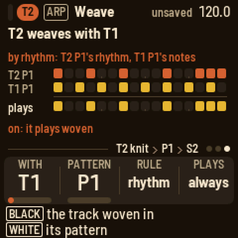 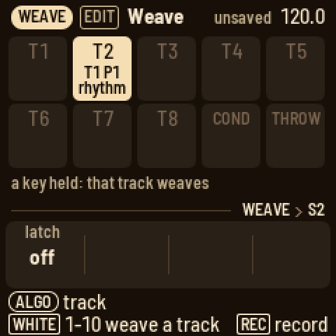

## Recording

- **Live recording**: hold **REC** and press **PLAY**. Every track starts from step 1 and recording starts at
  once (after the count-in, if one is set); the keys write steps as you play, quantised by QUANT, and chords
  land on one step together. Press **PLAY** to stop.
- **While playing**: hold **REC** and play. It records only while you hold **REC**. Hold **REC** and press
  **PLAY** to keep it on; press **REC** again to turn it off.
- **Chords on the conductor**: turn **ALGORITHM** to COND and record the same way. Each chord lands on the
  nearest step (set its scale to 4 on the Bar page, so a step is a beat), and a new chord replaces the one
  that was there.
- **Record settings**: hold **REC** and turn the knobs: CLICK (off, while recording, on), COUNT (a count-in of
  off, 1 or 2 bars), QUANT (how far notes are pulled onto the steps) and MODE (overdub adds to the pattern;
  replace clears the steps the playhead passes as you record over them). Holding **REC** to turn them
  changes nothing else.
- **Step by step**: stopped, tap **REC**. On Steps the keys become a keyboard and a red cursor marks the
  step they write, starting after the pattern's last note. A key, or keys held together, writes the step and
  the cursor moves on when you let go. **OCT+** leaves a rest, **OCT−** goes back a step. On a drum track the
  sound is added to the step. Tap **REC** again to stop. It works on the sound pages too, with a strip of the
  bar along the foot of the screen.
- **Throws** you hold while recording are written into the THROW track's pattern.

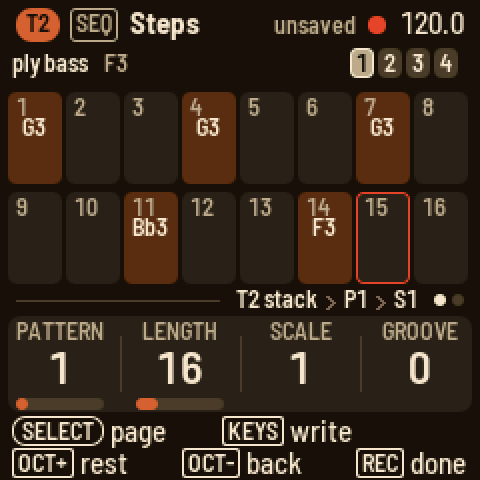

Hold **HOME** and press **REC** to undo the last change to the pattern. Hold **HOME** and press **PLAY** to
redo it. One stage, the selected track's pattern; locks stay as they are.

## Sounds

Press **EDIT**. The Engine page shows the track's engine, a picture of it that moves with the knobs, and its
four knobs with their values from 00 to 99. Turn **PRESETS** for the engine's next
sound: its factory presets, then the user presets saved from it; the message says where you are, as in
"PRESET 3/8". Press **SEL** for the list: ENGINE changes the engine and loads its first sound, then a preset,
SCRAMBLE for a random sound, SAVE AS PRESET, RESET SOUND, and whether the track FOLLOWS CONDUCTOR.

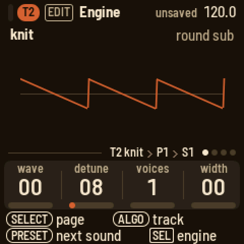 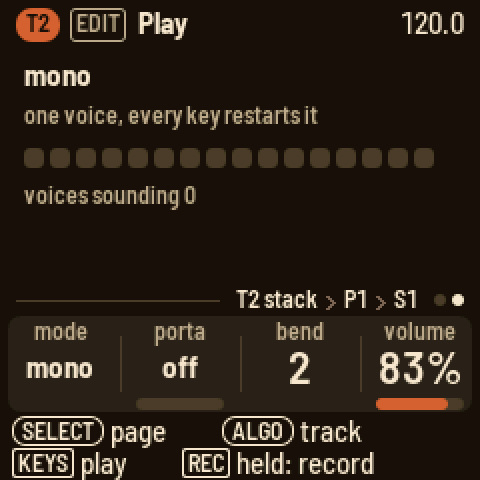

| Engine | Knobs |
| --- | --- |
| simple | shape, pw, noise, stereo |
| stack | shape, ratio, detune, stereo |
| wavetable | table, position, warp, drift |
| orbit | tone, ratio, shape, tremolo |
| epiano | tone, texture, punch, tine |
| organ | type, bass, tremolo, speed |
| sync | freq, sub, noise, lowcut |
| swarm | swarm, am, fm, detune |
| brocade | saws, detune, mix, spread |
| cane | model, timbre, color, damp |
| voile | model, timbre, color, breath |
| gingham | model, timbre, color, arp |
| kit | the shown key's model knobs |
| sample | sample, start, length, mode |
| slice | sample, slices, pitch, gate |

### Brocade

Brocade is the supersaw: up to nine saws a voice, detuned against each other, the big trance sound. Its saws
are NuSaw's. **saws** sets how many, from one to nine: a centre saw and pairs either side. **detune** spreads
their pitches, fine at first and wide at the end. **mix** sets the side saws against the centre one: low, one
saw with a shimmer; high, a wall. **spread** opens the pairs across the stereo field. The filter, the envelopes
and the LFO work on it as on any engine; an LFO on detune makes it swirl.

Nine saws cost about two ordinary voices. So brocade plays at most six voices, five with seven or eight saws, and
four with nine; a new note past that takes its oldest. When the FM-1 runs short of time, brocade thins first: its
voices lose their outer saws, two at a time, fading out so you hear no click. The saws come back when it is
calm again. Status shows it beside the voices, as "saws 7".

### Cane, voile and gingham

Three engines from Mutable Instruments' Braids, Émilie Gillet's macro oscillator, each a family of its models.
**model** picks one; **timbre** and **color** are Braids' own two knobs, and what they do depends on the model;
the fourth knob is LOOM-8's.

**Cane** is the physical models: instruments built from their parts, a string, a tube, a bell.

| Model | timbre | color |
| --- | --- | --- |
| pluck | how long the string rings | how wide the pluck: hollow to full |
| bow | how hard the bow presses | where it crosses the string |
| reed | how steady the breath (less noise) | the body's tone |
| flute | how breathy, high is clean | how hard it is blown |
| bell | how long it rings; at the top it never stops | the partials pulled apart |
| drum | how long it rings | from tone to rattle |

**damp** darkens it: a softer pluck, a duller bridge or bore, the bell's and the drum's upper partials dying
first. A pluck or a strike plays at each note; the bow and the breath start again on each note, and in legato
they carry on while the pitch moves. Cane plays at most four voices at once (each keeps its strings and tubes in
memory of its own); a new note past that takes its oldest. Very low notes the bow or the flute cannot reach
sound an octave up.

**Voile** is the voices.

| Model | timbre | color |
| --- | --- | --- |
| vosim | the first formant | the second formant |
| vowel | the vowel, through nine | the formants' shift |
| choir | the vowel: a, e, i, o, u | the singer: bass to soprano |
| whisper | how sharp the two peaks | how far the second is from the note |

**breath** is the noise in the voice: on vosim and choir the air through it, on vowel the consonant at the
start of each note (none to long), on whisper the share of noise against a buzz (all the way up, a whisper).

**Gingham** is the toys and the chips.

| Model | timbre | color |
| --- | --- | --- |
| toy | the sample rate, from crushed to clean | the bits flipped |
| chord | the second note's interval | the third note's interval |
| ring | the second sine's pitch | the third sine's pitch |
| peak | the resonance's pitch | its shape: saw, square, triangle |
| band | the same, hollower | the same |
| noise | the noise's loop, white to pitched | its steps, from one bit to smooth |

**arp** runs the note through a chord fifty times a second, the way chip music does: oct, fifth, power, major,
minor, maj7, min7, sus4, or off. On chord, the whole chord arpeggiates.

Most of these models cost about as much as any voice; cane's bell, with its eleven partials, about two.

### Kit

A drum track has eleven keys on the black keys, each with a drum model: kick, snare, hat, clap, shaker,
tambourine, string (a plucked string), conga, tom, fm or sample. The kit is tuned to C: kick G1, snare G3, low tom C3,
high tom G3, conga C4, string C3, fm C5. Press a black key, or turn **PRESETS**, to pick the key the
knobs edit. The Engine page's four knobs are the model's own:

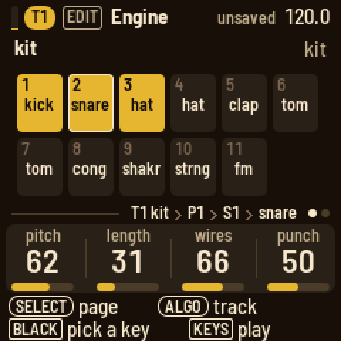 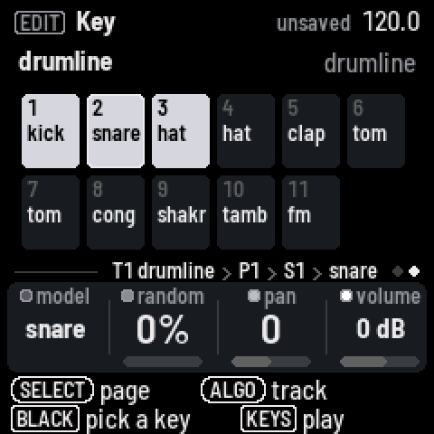 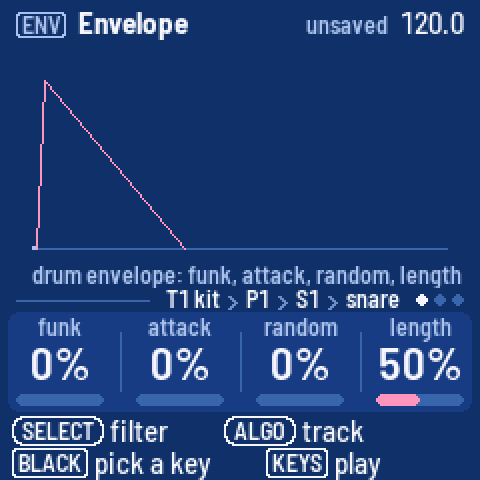

| Model | Knobs |
| --- | --- |
| kick | pitch, length, punch, tone |
| snare | pitch, length, wires, punch |
| hat | pitch, length, metal, focus |
| clap | tone, length, spread, tail |
| shaker | color, length, swell, return |
| tambourine | tone, length, jingle, hiss |
| string | pitch, length, bright, pluck |
| conga | pitch, length, slide, drive |
| tom | pitch, length, sweep, rate |
| fm | pitch, length, mod, feedback |
| sample | sample, pitch (24 semitones each way), start, reverse |

On every sound page of a drum track, a black key picks the key the knobs edit. Turn **SELECT** for the
key's page: the model, random (a variation on every hit), pan and volume in dB; its **SEL** list has the play
mode: one-shot, gated, loop, or choke groups 1 to 3. A new model starts from its own knobs.

**ENV** on a drum track has four pages. The first two are the shown key's own, after its model:

- **Envelope**: attack (a rise from silence, up to a second), hold (full level, up to a second), decay (a fall
  to silence; at "off" the model's own length decides) and lag (the key starts up to 60 ms late: a lazy snare,
  a flam). The picture draws the shape; the key's name is in the line above the knobs.
- **Filter**: cutoff (50 Hz to 20 kHz), resonance, env (how far the key's envelope moves the cutoff, up or
  down: with a decay set, a sweep on every hit) and drive (the key squared off, its level kept). **PRESETS**
  picks the type: off, low-pass, high-pass or band-pass. The picture draws the curve, and faintly where the
  envelope takes it.

A key left as it comes (attack, hold and lag at 0, decay off, no filter, no drive) sounds as its model alone
and costs nothing. Then two pages for the whole kit:

- **Kit env**: lag (a delay before every hit), attack, random (every key's knobs vary on each hit) and length
  (every model's length scaled).
- **Kit filter**: the kit's bus, after the keys are summed: low cut, compression, drive and hi cut.
  **PRESETS** turns it on or off.

Locks reach a key's own: hold a step and press **ENV**, and the knobs are the envelope (then, turning
**SELECT**, the filter) of the step's key: the one shown if the step plays it, else the step's first. The
line above the knobs names it.

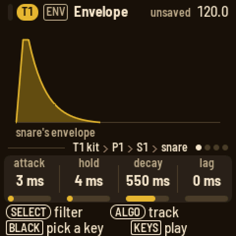 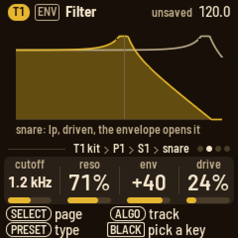

The **sample** model plays a sample of the bank (below) on the key: sample picks it, pitch tunes it 24
semitones either way of its own rate, start begins later in it, reverse plays it from its end back to the
start. It plays to the sample's end, or as long as the key's decay lets it. Four sample keys sound at once; a
fifth takes the oldest's place.

### Samples

LOOM-8 carries a bank of samples: eight of its own, made for now as placeholders (kick, snare, hat, clap, ah,
piano, sweep, and break: a bar of drums at 120 BPM for the slice engine), then sixteen of yours, user 1 to
user 16. The sample model on a drum key and the sample engine
on a synth track both play them, the knob naming each one.

The **sample** engine plays a sample at the pitch of the note: the sample's root note plays it at its own rate,
an octave up twice as fast. Its knobs:

| Knob | What it does |
| --- | --- |
| sample | which one (an empty user slot plays nothing) |
| start | where it begins, 0 to 99 % in |
| length | how much of the rest plays, to its end at 100 % |
| mode | one-shot (once, then the note ends), loop (round and round; a sample with its own loop loops that), reverse (once, backwards), ping-pong (forth and back) |

The picture shows the sample's waveform, the part that plays bright, a dot where it starts and the loop's ends
marked. Then the track's envelopes, filter, character and LFO shape it like any engine. Its eight presets:
jute keys, jute choir, hessian, hemp bass, sisal sweep, raffia, coir and flax bell.

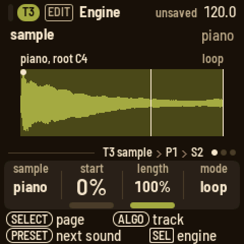

### Slice

The **slice** engine cuts a loop (a break) into even slices and plays one a note: the sample's root note plays
slice 1, the next note up slice 2, and so on, round again after the last (with eight slices, F3 to C4 are
slices 1 to 8 and C#4 is slice 1 again; below the root they count back from the last). On the keys at their own
octave, F3 (the lowest key) is slice 1 of the factory break. Written on the steps, the slices replay the break
(slice k on every other step, for eight slices of a bar) or make a new one from its pieces: any order, repeats,
gaps. Its knobs:

| Knob | What it does |
| --- | --- |
| sample | which loop (the factory break, or one of yours) |
| slices | 4, 8, 16 or 32 even slices |
| pitch | 24 semitones either way: down, a slice plays slower and longer than its place; up, faster and shorter |
| gate | how much of each slice plays, to all of it at 100 %; a short fade at both ends, so a cut never clicks |

A loop that says how many bars it is follows the tempo: its bars last as many bars of the song, so at 90 BPM the
factory break (a bar at 120) plays slower, each slice still on its steps; the pitch knob goes on top. A sample
that does not say plays at its own speed (the picture says "own speed"). In poly mode each note plays its slice
to its gate and overlaps the next; mono cuts the playing slice for the new one (a quick fade, then its start);
legato moves to the new slice at the same place in it, the time running on. Then the envelopes, filter,
character and LFO shape it like any engine (the presets keep the filter's keytrack at 0, so every slice sounds
alike, and a long release, so the gate decides the length rather than the step). Choosing the engine from **SEL**
takes the track off the conductor: its notes pick slices, and a chord change would move them (FOLLOWS CONDUCTOR
turns it back on).

The picture shows the loop's waveform cut at the slices, each slice's gated part drawn and what the gate leaves
out faint, the slice playing lit with a line where it is, a dot on slice 1. Above: the loop's name and bars,
the count or the slice playing. Its eight presets: loom break (eight slices, straight), chop (sixteen, mono),
shuttle (thirty-two, driven), heddle (four, an octave down, heavy), treadle (up a fifth, clipped), bobbin
(short plucked chops), selvedge (thin, high-passed) and warp beam (legato, down, a filter moving with the beat).

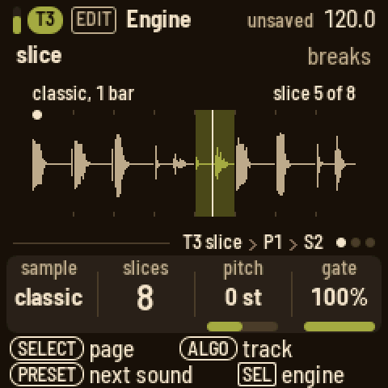

**Your own samples.** Connect the FM-1 (running LOOM-8) to a computer by USB and run, from the firmware's
folder:

```sh
pip install mido python-rtmidi
python3 tools/loom_samples.py load kick.wav snare.wav "vox=ah_A3.wav" "pad=pad.wav:57" "amen=amen.wav@1"
python3 tools/loom_samples.py info
python3 tools/loom_samples.py erase
```

`load` replaces the user samples with the files given, in that order: user 1, user 2... Each WAV (any rate,
mono or stereo, 8 to 32 bit) is made mono at 22050 Hz and its peak evened out. `NAME=` names it on the screen
(11 characters; else the file's name); `:ROOT` is the note that plays it at its own pitch on a synth track
(else a note in the file's name, as "ah_A3", or C4). A loop in the WAV is kept. `@BARS` says the file is a
loop of that many bars (1 to 16), for the slice engine: it then follows the tempo, and its root (slice 1) is F3
unless `:ROOT` says otherwise; the tool prints the tempo the loop has at its own speed. Trim the loop to exactly
its bars first: the slices are even cuts of the whole file. The bank holds about four seconds of sound in all
(a bar at 120 BPM is two seconds); `loom_samples.py` says when the files are too long. The sound stops for a few seconds
while it writes; then the screen says LOADED. A sample a track was playing keeps its place: user 2 is still user
2, whatever is in it now.

### The synth pages

Turn **SELECT** on Engine for Play: poly, mono or legato, portamento, the bend range (off, 1 to 7
semitones, an octave) and the track's volume.

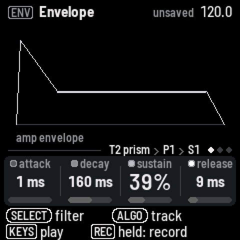 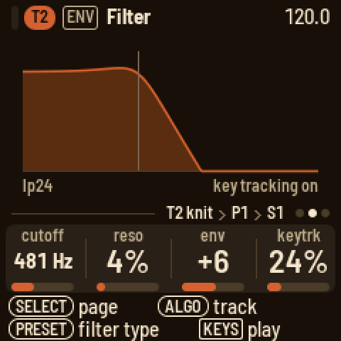 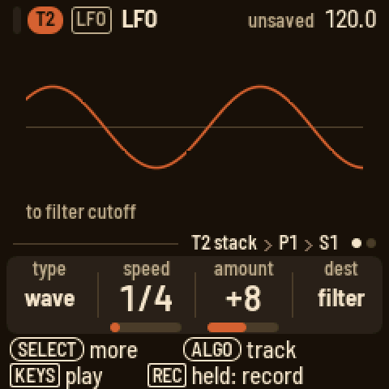

**ENV** has the amp envelope, then the filter: cutoff in Hz, resonance, envelope amount and key tracking,
with **PRESETS** turning the type (svf, ladder, z lowpass, z hipass, dynamic); then the filter's envelope.
**FX** has the track's character (below), then its sends to FX I and FX II, its pan and its level, then the two
effects. **LFO** has the
type and its first three knobs; page 2 its fourth and fifth. A new type starts from its own defaults:

| Type | Page 1 | Page 2 |
| --- | --- | --- |
| value | speed, amount, destination | parameter, shape |
| random | speed, amount, destination | parameter, envelope |
| tremolo | rate, vibrato, volume | envelope, shape |
| duck | source, amount, hold | release |

The speed knob is synced from 2/1 to 1/64 turned left, and free in Hz turned right. A destination with
"free" after it runs on without restarting on each note.

### Character

Every voice of a synth track has an effect of its own after the filter, before the sends: its character.
Each voice is shaped on its own, so a chord driven hard stays a chord. Press **FX**: the Character page shows
the type, what it does and a picture of it: the curve a sample goes through, or what it does to a wave. The
faint line is the sound without it. **PRESETS** turns the type. The knobs are type, amount, tone and mix (dry
to wet); at mix 0 it is off. The factory presets each have their own, so a preset is a whole sound.

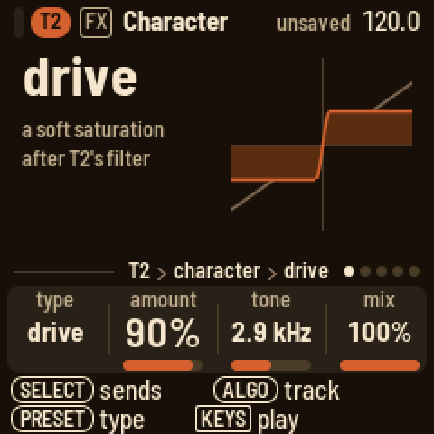

| Type | Amount | Tone |
| --- | --- | --- |
| off | | |
| drive | how hard it saturates (the level stays) | a low-pass after it, 400 Hz to 20 kHz |
| fold | how far the wave folds over (the level stays) | the bias: off the middle, it folds one side more |
| crush | how far it falls | which falls: left the sample rate, right the bits, the middle both |
| ring | how deep the ring modulation | the ratio of the ring's sine to the note, 0.25:1 to 7:1 |
| tilt | the pivot, 150 Hz to 6 kHz | the tilt: left darker, right brighter, 6 dB each side at the ends |

Lock the amount, tone or mix on a step like any knob (hold the step, press **FX**). The LFO reaches the amount:
the amp module's fourth knob, "character". A drum track's voices have no character: on a kit the page says
so.

## Players

Press **ARP**. **KNOB 1** picks the player: off, arp, strum or hold.

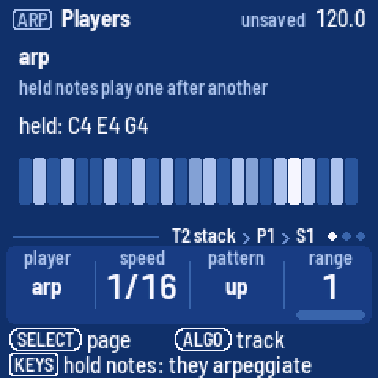

- **arp** plays the held notes one after another: speed (1/4 to 1/64, with triplets), pattern (up, down, up
  down 1, up down 2, as played, random) and range on page 1; page 2 has the note length, a style, glide and
  stereo; page 3 is hold.
- **strum** plays a chord from one key. Press **REC**, then hold the chord, up to eight keys: it is
  recorded. From then on any key plays it, moved to that key. Roll strums it, up to one note per step.
- **hold** keeps the notes you play until the next.

## Arrange, scenes and the song

Press **HOME**. Each row is a track with its pattern and a playhead; muted tracks are dimmed. The scene's
number is at the right, with the next one when a scene is cued. The 16 white keys are the 16 scenes:
press one to switch at once. Hold **HOME** and press one to cue it for the next bar. An empty scene
becomes a copy of the scene playing. Hold a white key for a second to clear that scene. The black keys
mute: 1 to 8 the tracks, 9 and 10 the conductor and the throws. Hold **HOME** and turn **PRESETS** to change scenes
from any page.

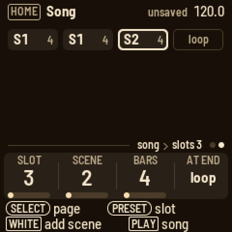

**KNOB 1** is the tempo (hold **HOME** for tenths), **KNOB 2** the groove type (swing, lilt, weave,
stretch, drunk, jitter, accent, lazy, push pull, sway, swell), **KNOB 3** the
selected track's groove amount from −99 to 99, and **KNOB 4** the click: off, while recording, or on.

Turn **SELECT** for the Song page. Press a white key to add that scene at the cursor. **KNOB 1** moves the
cursor, **KNOB 2** changes the slot's scene, **KNOB 3** how many times it plays, and **KNOB 4** whether the
song loops or stops at the end. **PLAY** on the Song page plays the song from slot 1. **SEL** inserts the
scene playing, deletes a slot or clears the song.

## The aux tracks

Turn **ALGORITHM** past T8. Each aux track has its own page under **EDIT** and its own steps under **SEQ**.

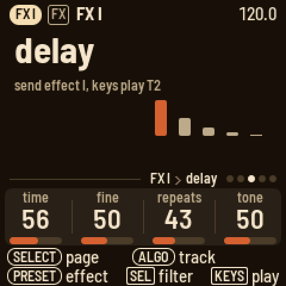 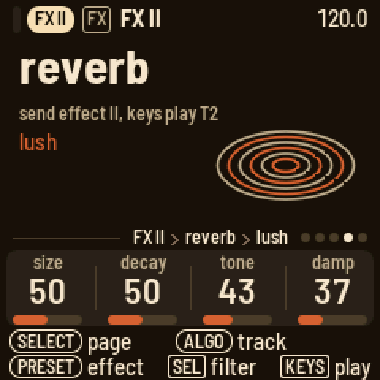

- **COND** (the conductor): mode (manual, or auto: the key is detected from the tracks that follow), key, scale and link,
  an instrument track that also plays the conductor's keys. Play a chord on its keys: the tracks that follow
  move to it. Its steps hold the chords you played: press **SEQ** and a white key. Set the track scale to 4
  so a step is a beat, or 16 for a bar. Page 2 is the routing: black keys 1 to 8 toggle a track. Its
  **SEL** list sets how each track follows, diatonic or transpose only. Drum tracks never follow.
- **THROW** (the throws): the keys fire the throws on the drum tracks (lower octave) and the melodic tracks
  (upper octave). Slice tracks count as drums: their fills play the pattern's own slices (the one on the
  downbeat as the kick, the backbeat's as the snare, an off-beat's as the hat), and octave takes them up. The last one you played is the one a step writes. **KNOB 1** is latch: a key then
  toggles its effect.

| Key of the octave | Effect |
| --- | --- |
| white 1 | mute: silences the group |
| white 2 | stutter: a fast loop from where the throw starts |
| white 3 | repeat: a slow loop |
| white 4 | echo: the loop repeats and fades |
| white 5 | build: a fill that builds |
| white 6 | floor: four on the floor |
| white 7 | jumble: a random fill |
| black 1 | warble: high-passed drums, vibrato on melodic notes |
| black 2 | pan: the sounds move across the field |
| black 3 | octave: drums an octave up, melodic tracks an octave down |
| black 4 | chop: short notes |
| black 5 | ring: long notes |

  On any other page, hold **HOME** and press a key: the lower octave works on the track you are on, the
  upper octave on its whole group.

- **FX I** and **FX II**: a send effect each: chorus, delay, lofi, phaser or reverb, with its
  four knobs. Press **FX** and turn **SELECT** to reach them from any track: **PRESETS** picks the effect, and
  **SEL** has its high-pass, low-pass and, on FX I, the send into FX II. The keys play the track you were on.
  Turned to with **ALGORITHM**, they have the same knobs on **EDIT**.

| Effect | Knobs |
| --- | --- |
| chorus | rate, depth, feedback, width |
| delay | time, fine, repeats, tone (how bright the repeats are) |
| lofi | rate, bits, smooth, width |
| phaser | freq, depth, rate, feedback |
| reverb, plate | size, motion, tone, damp (how fast the tail darkens) |
| reverb, the other modes | size, decay, tone, damp |

  The effects return only what they make: the track's own sound stays on the track.

  The reverb has ten modes, and **PRESETS** walks through them after the phaser: **plate**, LOOM-8's own, and
  nine from the PlayStation's sound chip, the reverbs its games used: **room**, **studio S**, **studio M**,
  **studio L** (small, medium, large), **hall**, **half echo**, **space echo**, **chaos echo** (it almost never
  stops) and **one echo** (a single repeat). They keep the console's grain: they run at half the sample rate.
  On these, **size** stretches their delays, from small and metallic at 0 to the console's own at the top (the
  new mode's starting point); **decay** sets how long the tail lasts, the console's own in the middle;
  **tone** darkens the tail below the middle and thins it above; **damp** softens the reflections. Changing
  the mode empties the reverb for a moment. Only FX II has the reverb: FX I has the delay's memory instead.

## Mix and master

Press **GLO**. The Mix page shows a meter for each track; the black keys pick one, and hold one to solo it.
Hold **HOME** and press a black key to mute. The knobs are the sends to FX I and FX II, the pan and the
level. Turn **SELECT** for Master EQ (low, mid, high and a blend from flat to the EQ), Master tape, and
Master out (the drums' level, the melodic tracks' level, the compressor and the output level). Setup has the lights, MIDI clock and notes out, and one or two cores; its **SEL** list loads
a project, starts a new one, and sets the USB audio level, the count-in and the theme (tape deck or blueprint). Status shows the audio load, the
voices and the second core.

Master tape puts the whole mix through a tape (TapeScam-lite, after the TapeScam plugin): **drive** pushes
it into the tape's preamp, harder and denser (the low end goes around it, so the kick stays); **color** is the
tape's saturation, rounder and a little darker as it goes up; **wobble** is wow and flutter, the pitch
wavering on both sides together, as on one tape (so the mix holds up on the FM-1's one speaker); **noise** is
the hiss. Even pushed hard it stays smooth rather than gritty in the highs. With all four at 0 the tape is out
of the path. A new project starts with a little color (24) and nothing else. The tape keeps the level about
where it was: turning drive or color changes the sound, not how loud it is.

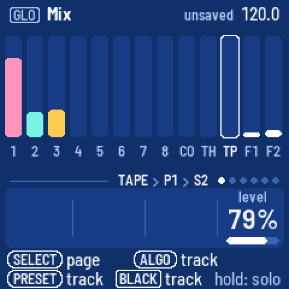 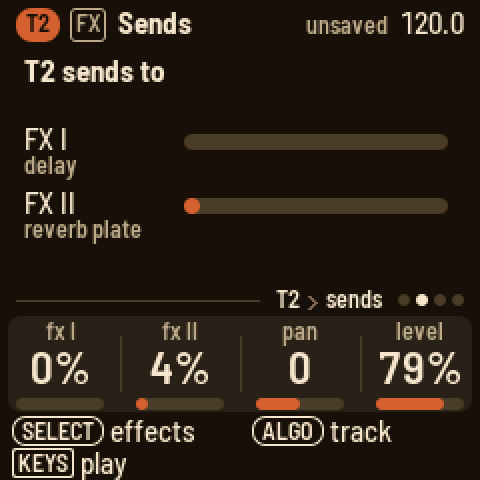 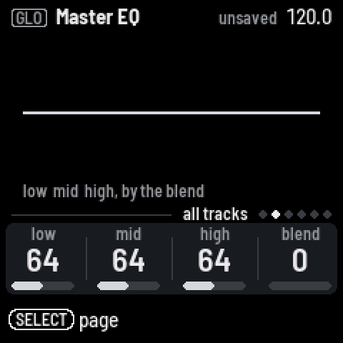 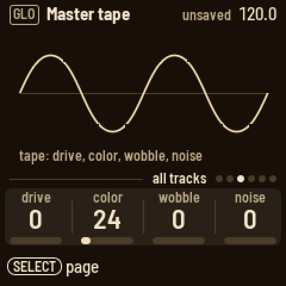 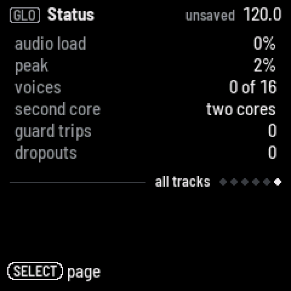

## Saving

Press **SAVE** to save the project to its slot. Hold **SAVE** and press white key 1 to 3 to save it to that
slot; LOOM-8 asks first if the slot holds another project. The header says "unsaved" and **SAVE** lights
while there are changes to save. LOOM-8 does not save by itself.

**Backup.** To keep the three projects and the user presets on a computer, and put them back later, open
<https://charlesvestal.github.io/fm1-loom/backup/> in Chrome or Edge with the FM-1 connected by USB (or run
`python3 base/tools/fm1_backup.py backup FILE --magic LM8B` from the firmware's folder; `restore FILE` puts it back). A backup holds them as saved: save first what you
want in it. Putting one back replaces all three projects and the presets; LOOM-8 asks first, on its screen
(**SEL** yes, **HOME** no), and only while stopped. Your own samples are not in a backup: keep their WAV files,
and load them again with `tools/loom_samples.py`.

On a sound page, hold **SAVE** and press white key 1 to 16 to keep the track's sound as that user preset.

## Page by page

| Button | Page | KNOB 1 | KNOB 2 | KNOB 3 | KNOB 4 | Keys |
| --- | --- | --- | --- | --- | --- | --- |
| HOME | Arrange | tempo | groove | amount | click | white: scenes, black: mutes |
| HOME, SELECT | Song | slot | scene | repeat | at end | white: add a scene |
| SEQ | Steps | pattern | length | scale | groove | white: steps, black: sound (drums); SEQ held: a keyboard |
| SEQ, a step held | Steps | velocity | length | chance | nudge | white: length, black: sounds |
| SEQ, HOME + a step | Steps | the tricks and values shown | | | | white: trick, black: value |
| SEQ, SELECT | Bar | quant | note | groove | shape | black: scale |
| EDIT | Engine | the engine's four | | | | play |
| EDIT, SELECT | Play | mode | porta | bend | volume | play |
| EDIT, drum track | Engine, Key | the key's knobs; model, random, pan, volume | | | | black: the key |
| ENV | Envelope | attack | decay | sustain | release | play |
| ENV, SELECT | Filter | cutoff | reso | env | keytrack | play; PRESETS: the type |
| ENV, SELECT twice | Filter env | attack | decay | sustain | release | play |
| ENV, drum track | Envelope | the key's attack | hold | decay | lag | black: the key |
| ENV, drum track, SELECT | Filter | the key's cutoff | reso | env | drive | black: the key; PRESETS: the type |
| ENV, drum track, SELECT twice | Kit env | lag | attack | random | length | play |
| ENV, drum track, SELECT 3 times | Kit filter | low cut | comp | drive | hi cut | play; PRESETS: on or off |
| FX | Character | type | amount | tone | mix | play; PRESETS: the type |
| FX, SELECT | Sends | fx I | fx II | pan | level | play |
| FX, SELECT twice | FX I, FX II | the effect's four | | | | play; PRESETS: the effect (and the reverb's mode) |
| LFO | LFO | type | the type's three | | | play |
| LFO, SELECT | LFO 2 | the type's fourth and fifth | | | | play |
| ARP | Players | player | its first | its second | its third | play, through the player |
| ARP, SELECT | Players 2, Hold | the arp's length, style, glide, stereo; hold | | | | play |
| GLO | Mix | FX I | FX II | pan | level | black: the track, held: solo |
| GLO, SELECT | Master EQ | low | mid | high | blend | |
| GLO, SELECT | Master tape | drive | color | wobble | noise | |
| GLO, SELECT | Master out | perc | mel | comp | level | |
| GLO, SELECT | Setup | lights | clock | notes | cores | |
| GLO, SELECT | Status | | | | | |

The aux tracks' Engine page: COND has mode, key, scale and link, and page 2 the routing; THROW has latch;
FX I and FX II have the effect's four knobs, and on page 2 hp, lp
and the send to FX II.

## Screen reader

Connect the FM-1 by USB and open https://charlesvestal.github.io/fm1-reader/ in Chrome or Edge. LOOM-8 says
each page, knob value, step, scene and message as it changes, and the whole screen when you ask. The words
it uses are published with this site, so every version reads its own screen correctly.

## Credits

LOOM-8's way of working owes a great deal to teenage engineering's OP-XY; LOOM-8 is not affiliated with
teenage engineering. Built on fm1-base and felucca-bsp, from Felucca by Leo Kuroshita (Hügelton Instruments),
with Polly's menus, X0X's sequencer discipline and NuSaw's second core.
